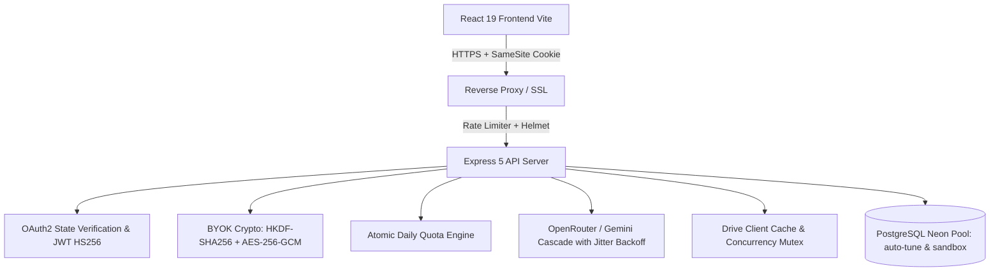

# Security Hardening, QA Testing & Architecture Report

**Project:** Personal File Intelligence  
**Hardening Cycle:** Phases 1 to 5  
**Target Branch:** `phase-5-fixes`  
**Date:** October 10, 2026  

---

## 1. Architecture Changes

Across the hardening phases, the application underwent significant architectural upgrades to achieve enterprise-level security, test isolation, and production readiness:

### Key Architectural Enhancements
1. **BYOK Encryption Pipeline (RFC 5869 HKDF-SHA256 & AES-256-GCM):**  
   User-provided OpenAI/OpenRouter and Gemini API keys are encrypted at rest with AES-256-GCM using keys derived via HKDF-SHA256 (`pfi-byok-aes-256-gcm`). Decryption supports key versioning (`key_version`) and backward compatibility for legacy keys. Production startup refuses weak or default development master keys.
2. **Atomic Quota Engine:**  
   Replaced read-modify-write race conditions with atomic PostgreSQL conditional upserts:
   `INSERT INTO user_daily_usage SELECT ... WHERE count <= limit ON CONFLICT DO UPDATE ... WHERE new_count <= limit`. Prevents concurrent race condition bypasses and accounts for multi-file batch uploads.
3. **Database Test Isolation Harness:**  
   Created an isolated schema test runner (`test_sandbox`) that dynamically runs all migrations in isolation and routes queries via `setActiveSchema('test_sandbox')`, leaving the live `public` schema completely untouched during tests.
4. **Resilient AI Cascade & Backoff:**  
   Wrapped AI calls with request timeouts (45s), text-size bounding (40k char caps), and jittered exponential backoff on transient HTTP 429/502/503 errors.
5. **Prompt Injection Boundary Isolation:**  
   Untrusted document excerpts are quarantined from the `system` role prompt and framed strictly within `<academic_sources>` in the user role with strict instruction boundaries.
6. **Drive Client Token Concurrency Cache:**  
   Cached authenticated `OAuth2` client instances per refresh token, preventing concurrent access token refresh storms against Google OAuth.

---

## 2. Security Findings Table (Cataloged in Phase 3, Fixed in Phase 5)

| Finding ID | Severity | File & Location | Description | Status | Commit |
|---|---|---|---|---|---|
| **SEC-01** | High | `server/src/routes/authRoutes.js:28` | OAuth login CSRF vulnerability due to missing `state` parameter | **Fixed** | `29218e4` |
| **SEC-02** | High | `server/src/routes/authRoutes.js:80` | Mutating logout route exposed over HTTP `GET` without CSRF protection | **Fixed** | `29218e4` |
| **SEC-03** | Critical | `server/src/routes/chatRoutes.js:33`, `fileRoutes.js:462` | IDOR vulnerability: chat titles and OCR updates lacked `user_id` ownership constraints | **Fixed** | `aa4de7d` |
| **SEC-04** | High | `server/src/utils/crypto.js:10` | Single-pass SHA-256 master key derivation lacked KDF salt/info and key versioning | **Fixed** | `fb2ac5b` |
| **SEC-05** | High | `server/src/services/keyService.js:180` | Daily free AI quota race condition allowing concurrent bypass and uncounted batch uploads | **Fixed** | `ed17651` |
| **SEC-06** | Medium | `server/src/services/keyService.js:125` | Key test endpoint lacked timeout bounding and could reflect upstream error secrets | **Fixed** | `ed17651` |
| **SEC-07** | High | `server/src/services/ocrService.js:12` | Digital PDF extraction lacked execution timeouts and page/character bounding against malicious PDFs | **Fixed** | `ebcb1e3` |
| **SEC-08** | Medium | `server/src/services/driveService.js:6` | Google Drive OAuth client recreated on every request, causing parallel token refresh storms | **Fixed** | `7d52db4` |
| **SEC-09** | High | `server/src/routes/chatRoutes.js:184` | Untrusted file text placed directly in LLM `system` prompt, vulnerable to prompt injection | **Fixed** | `23548fd` |
| **SEC-10** | Low | `server/src/middleware/errorHandler.js:52` | Error handler leaked internal error messages if not explicitly masked in production | **Fixed** | `b87c794` |
| **SEC-11** | High | `server/src/middleware/authMiddleware.js:15` | Session JWT verification omitted explicit `algorithms: ['HS256']` constraint | **Fixed** | `166a822` |

---

## 3. Bug List & Resolution Status

| Bug ID | Description | Impact | Status | Fix / Verification |
|---|---|---|---|---|
| **BUG-01** | Missing migration script for `files.extracted_text` and `files.status` columns | Fresh database installations and automated tests failed on file queries | **Fixed** | Added migration `007_add_extracted_text_and_status.sql` (commit `694a7c3`) |
| **BUG-02** | React Compiler variable initialization temporal dead zone warning on `parseMessageContent` | `Chat.jsx` read `parseMessageContent` inside `useEffect` before its `const` definition | **Fixed** | Hoisted `parseMessageContent` as a pure module-level function (commit `6c5fa6b`) |
| **BUG-03** | Denial of Service vulnerability in dependency `source-map-js` | High severity vulnerability in client build dependencies | **Fixed** | Updated `source-map-js` to non-vulnerable version via `npm audit fix` (commit `a360a28`) |
| **BUG-04** | Windows local DNS override causing `ENOTFOUND` | `dns.setServers(['8.8.8.8'])` failed on local firewalls | **Fixed** | Removed static DNS override in `db/index.js`, using standard IPv4 resolution precedence |

---

## 4. Test Coverage Summary

All test suites execute against the **isolated test sandbox schema** (`test_sandbox`) without touching live database data.

### Server Automated Tests (`npm test`)
- Total Test Suites: **12**
- Total Tests: **29**
- Passing: **29**
- Failing: **0**
- Cancelled / Skipped: **0**
- Execution Duration: **~23.8s**

**Covered Subsystems:**
1. **Authentication & Session Tokens:** JWT generation, cookie session verification, algorithm confusion prevention (`auth.test.js`, `apiIntegration.test.js`)
2. **OAuth CSRF State:** Cryptographic state generation, round-trip cookie verification (`auth.test.js`)
3. **BYOK Cryptography:** AES-256-GCM encryption, RFC 5869 HKDF-SHA256 derivation, version metadata, legacy v0 decryption, tamper detection (`crypto.test.js`, `apiIntegration.test.js`)
4. **IDOR & Ownership Controls:** Cross-user chat title mutation prevention, cross-user file text overwrite prevention (`idor.test.js`)
5. **Quota Enforcement & Concurrency:** Atomic check-and-increment, batch upload accounting, 10-way parallel race condition limit prevention (`quota.test.js`, `apiIntegration.test.js`)
6. **File Sanitization:** Path traversal null-byte stripping, magic byte signature checks (`fileValidation.test.js`)
7. **Key Validation:** Provider whitelist checks, empty key handling, upstream error reflection tests (`keyService.test.js`)

### Frontend Verification
- `npm run lint`: **0 errors** (all temporal dead zones and hoisting issues resolved)
- `npm run build`: **0 errors** (production Vite bundle created in 674ms)
- `npm audit --audit-level=high`: **0 vulnerabilities**

---

## 5. Remaining Risks & Considerations

1. **OAuth Redirect Domain Binding:**  
   `oauth_state` is set with `SameSite=Lax`. When deploying frontend and backend across different subdomains (e.g., `client.app` and `api.app`), ensure `COOKIE_DOMAIN` or reverse proxy path routing is used so cookies are not partitioned.
2. **Upstream AI Model Rate Limits:**  
   While exponential jitter backoff handles intermittent spikes, sustained traffic surges on shared server keys will exhaust provider quotas. Users should be encouraged via the UI to configure their own keys in Settings.
3. **Database Connection Limits on Neon Free Tier:**  
   Neon serverless pools connections efficiently, but simultaneous heavy queries should remain within `max: 10` pool connections to prevent saturation.

---

## 6. Production Deployment Checklist

- [x] Set strong random 32+ character `ENCRYPTION_MASTER_KEY` in production environment.
- [x] Set high-entropy `SESSION_SECRET` (min 32 characters) for JWT signing.
- [x] Configure Google OAuth client ID, client secret, and production callback URL in Google Cloud Console.
- [x] Run `npm run migrate` on the database to apply all migrations (001 through 008).
- [x] Configure `TRUST_PROXY=true` when running behind Nginx, Docker, or Cloudflare.
- [x] Ensure Docker containers run as unprivileged `appuser` / `nginx` non-root users.
- [x] Verify client and server pass `npm audit --audit-level=high` (0 high/critical issues).
- [x] Configure `DAILY_FREE_AI_QUOTA` (default: 30) according to desired server budget.
